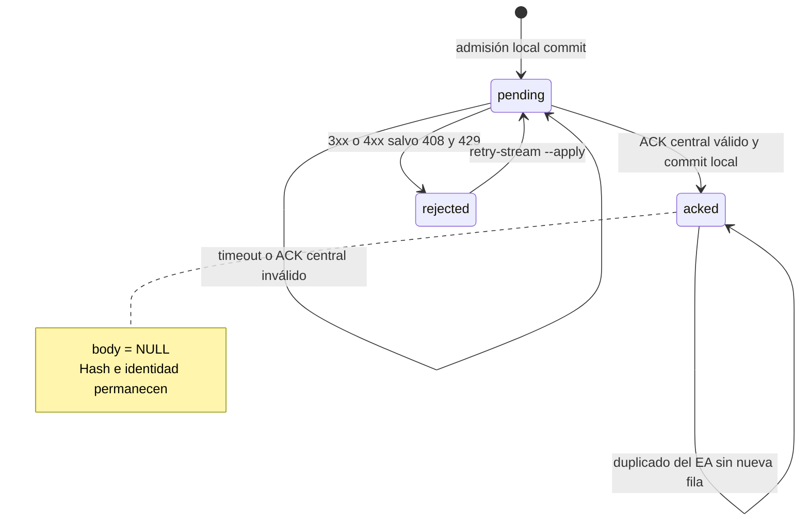
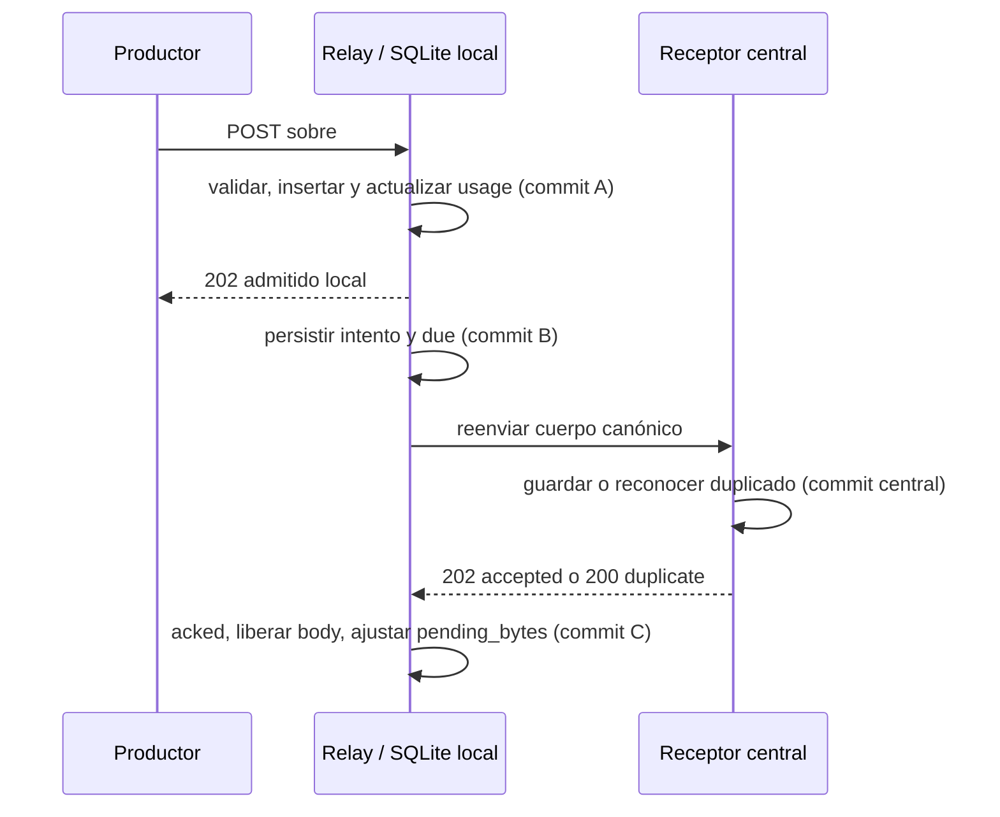

# Relay con outbox durable: primera entrega local

Estado: implementación optativa para prueba aislada; sin activación en MT5 ni
despliegue en la Mac. Nace de `feature/clean-sqlite-v5` (PR 57).

## Responsabilidades

Los EAs envían al relay en loopback. Solo después del commit local responde
202 (nuevo) o 200 (duplicado). Un worker reenvía el mensaje al receptor central
correspondiente v1/v2. Guarda el sobre canónico completo: identidad, captura y
payload originales; no rejuvenece tiempos ni genera otra secuencia al reintentar.

La outbox es una base SQLite propia, esquema 1; no es la base histórica SQLite
v5 ni requiere migrarla. El cuerpo se conserva hasta el ACK central válido y
luego se libera. La huella y la identidad permanecen para deduplicar reenvíos
del EA, incluso después de un reinicio. No se guardan tokens en la base.

El mismo commit local guarda cuerpo y metadatos. Si el proceso cae antes de
confirmar al EA, el EA puede repetir. Si el receptor central confirma en disco
pero se pierde el ACK, el relay repite el mensaje y valida el 200 de duplicado.

El relay autentica fuente, cuenta y rol antes de encolar. V1 conserva identidad
de cuenta en snapshots; sus heartbeats no incluyen esa identidad y se autorizan
por credencial/fuente. No se autoprovisionan productores.

## Esquema durable y ciclo de vida

La cola usa SQLite `user_version=1`. Las escrituras de admisión y los cambios
de estado relevantes son transacciones locales; el esquema se comprueba al
abrir junto con `quick_check` y la coherencia de los contadores.

| Tabla | Campo | Tipo / restricción | Uso |
| --- | --- | --- | --- |
| `messages` | `id` | `INTEGER PRIMARY KEY` | Orden local de admisión. |
| `messages` | `stream` | `TEXT NOT NULL` | Fuente/version, con forma `v1:source` o `v2:source`. |
| `messages` | `session` | `TEXT NOT NULL` | Sesión del sobre. |
| `messages` | `sequence` | `TEXT NOT NULL` | Secuencia decimal como texto; el highwater se compara por longitud y valor dentro de stream/sesión. |
| `messages` | `event_id` | `TEXT NOT NULL` | Identidad de evento para deduplicación. |
| `messages` | `digest` | `TEXT NOT NULL` | SHA-256 del cuerpo canónico completo. |
| `messages` | `body` | `BLOB` nullable | Sobre canónico hasta el ACK válido; se pone a `NULL` al confirmar. |
| `messages` | `state` | `TEXT NOT NULL`, `pending` / `acked` / `rejected` | Estado durable. No existe estado `sent`. |
| `messages` | `attempts` | `INTEGER NOT NULL DEFAULT 0` | Intentos de envío persistidos antes de la E/S. |
| `messages` | `first_seen` | `REAL NOT NULL` | Hora Unix UTC de admisión local. No es `captured_at`. |
| `messages` | `due` | `REAL NOT NULL DEFAULT 0` | Próximo instante Unix UTC elegible para reintento. |
| `messages` | `last_sent` | `REAL` nullable | Hora Unix UTC en que se persistió el inicio del último intento. |
| `messages` | `confirmed_at` | `REAL` nullable | Hora de inicio del intento que terminó confirmado; aproximación, no hora de recepción exacta del ACK. |
| `messages` | `error` | `TEXT` nullable | Error operativo asociado al pendiente o rechazo. |
| `messages` | restricciones | `UNIQUE(stream,session,sequence)`, `UNIQUE(stream,event_id)` | Impiden reutilizar una identidad dentro del stream. |
| `messages` | índice `pending_stream` | Parcial sobre `(stream,id)` donde `state != 'acked'` | Permite escoger el mensaje más antiguo aún no confirmado por stream. |
| `bindings` | `stream` | `TEXT PRIMARY KEY` | Identificador del stream vinculado. |
| `bindings` | `identity` | `TEXT NOT NULL` | JSON con cuenta, rol, identidad MT5 y target. La relación con `messages.stream` es lógica; no hay FK explícita. |
| `usage` | `id` | `INTEGER PRIMARY KEY CHECK(id=1)` | La tabla contiene una única fila de contadores. |
| `usage` | `records` | `INTEGER NOT NULL CHECK(records>=0)` | Registros totales, incluidos los `acked`, que retienen huellas para deduplicar. |
| `usage` | `pending_bytes` | `INTEGER NOT NULL CHECK(pending_bytes>=0)` | Suma de cuerpos en estado `pending` o `rejected`; baja al liberar el cuerpo tras ACK. |

Todos los tiempos `REAL` son segundos Unix UTC. `captured_at` solo pertenece al
sobre original; no determina `first_seen`, `last_sent` ni `confirmed_at`. La
fila inicial de `usage` es `(1,0,0)`. La admisión autentica y valida antes de
abrir una transacción `BEGIN IMMEDIATE`: reconoce primero duplicados por hash,
valida después el highwater y los límites, y guarda mensaje y contadores en el
mismo commit. Solo entonces responde al productor: HTTP 202 para nuevo, HTTP
200 para duplicado idéntico sin nuevas filas ni cambios de contador. El 200
local no confirma recepción central. Reutilizar identidad con distinto hash
da 409; saturación o error de almacenamiento da 503 sin admitir el mensaje.
Los duplicados reconocibles se resuelven antes de aplicar cuotas.

El worker considera el `id` menor no `acked` de cada stream. Un `rejected` o
un pendiente cuyo `due` aún no llegó bloquea ese stream, mientras los demás
streams pueden avanzar. El intento incrementa `attempts` y persiste `last_sent`
y `due` antes de la llamada de red. El backoff es
`min(300, 2**min(attempts_prev, 8))` segundos, es decir, de 1 a 256 segundos
con los valores actuales. Mientras se envía, el estado continúa `pending`.

Un ACK central válido es HTTP 200 (duplicado) o 202 (aceptado), con JSON
`application/json` de hasta 4096 bytes y los campos esperados validados:
`status`, `sequence_gap` entero no negativo y, para v2, `out_of_order` booleano.
El commit local posterior cambia a `acked`, borra el cuerpo y el error, registra
`confirmed_at` y resta el tamaño del cuerpo a `pending_bytes`; `records` no
cambia. Fallos de red, timeout, 5xx, 408 o 429 dejan el mensaje `pending` con
error y reintento programado. Redirecciones y otros 4xx lo dejan `rejected`,
conservando cuerpo y bloqueando ese stream. `--retry-stream` primero muestra
una vista previa; con `--apply` cambia los rechazados del stream a `pending`,
pone `due=0` y limpia `error`, sin modificar identidad, cuerpo ni intentos.



La confirmación requiere dos commits separados: primero el receptor central
confirma su escritura; después el relay registra esa confirmación en su outbox y libera el
cuerpo. Por tanto, una caída entre ambos puede reenviar el mismo mensaje y
recibir 200 por duplicado. Una caída después de persistir el intento pero antes
del envío espera hasta `due`; una caída antes del commit central permite
reintentar; y una caída después del commit de admisión local pero antes de la
respuesta hace que el productor pueda repetir y obtener la deduplicación local.
El transporte es al menos una vez, con deduplicación de efecto; no promete
exactly-once ni tolerancia a pérdida del disco sin respaldo.



La creación usa una base temporal verificada y un hard link que falla si el
destino ya existe. Un `RLock` serializa el acceso dentro del proceso y un lock
del sistema operativo limita el uso de la outbox a una instancia CLI. HTTP no
usa proxy ni sigue redirects; HTTPS valida certificados y HTTP solo se admite
para loopback en pruebas.

## Archivos de implementación relacionados

- [`relay_queue.py`](../../src/tradinglab/telemetry/relay_queue.py): esquema,
  admisión, deduplicación, cuotas, backoff y transiciones persistentes.
- [`relay.py`](../../src/tradinglab/telemetry/relay.py): ciclo del worker y
  coordinación de envíos por stream y autenticación de productores.
- [`relay_delivery.py`](../../src/tradinglab/telemetry/relay_delivery.py): protocolo
  inyectable, cliente HTTP central y validación pura del ACK. El forwarder recibe
  cola/productores/transporte directamente, sin depender de `RelayIngress`.
- [`relay_http.py`](../../src/tradinglab/telemetry/relay_http.py): listener,
  validación de encabezados y respuestas HTTP de admisión y salud local.
- [`relay_config.py`](../../src/tradinglab/telemetry/relay_config.py): carga y
  validación de configuración y referencias de credenciales.
- [`telemetry_relay.py`](../../scripts/telemetry_relay.py): entrada CLI para
  crear/abrir la cola, arrancar el relay y revisar o rehabilitar rechazos.

## Preparación aislada

Usar un directorio local privado existente y rutas absolutas, fuera de carpetas
sincronizadas o de red. Los ejemplos de rutas deben reemplazarse en cada equipo.

```text
uv run python scripts/telemetry_relay.py --queue "C:\TradingLabData\relay.sqlite3" --init-queue
```

El comando crea una cola nueva verificada y termina. No sobrescribe un destino.
En la Mac la ruta equivalente podría ser `/Users/tu_usuario/TradingLabData/relay.sqlite3`.
La cola permanecerá en la VPS cuando la API central esté en la Mac.

Copiar y adaptar [la topología de ejemplo](telemetry-relay.example.json) a un
archivo local. Define las identidades y targets; las credenciales se referencian
por nombre de variable. V1 utiliza rol live; v2 admite live/activity según fuente.
Configurar credenciales distintas para cada productor y frontera. El token local
debe coincidir con el EA; el central, con el receptor de destino.

Se admiten variables del proceso o un archivo local ignorado `.env.relay` con
asignaciones `RELAY_...=valor`, una por línea y sin comillas. No versionarlo ni
compartirlo. La topología no admite tokens literales. Para arrancar:

```text
uv run python scripts/telemetry_relay.py --queue "C:\TradingLabData\relay.sqlite3" --config "C:\TradingLabData\relay.json" --secrets-file .env.relay --port 8780
```

El listener queda en `127.0.0.1:8780` y admite ambas rutas POST, `/v1/telemetry`
y `/v2/telemetry`. `GET /health` informa estados, errores acotados, bytes de
cuerpos pendientes, antigüedad del más antiguo y última confirmación central
(Unix UTC en segundos, o null). No expone cuerpos ni tokens.

`ingress_rejections` añade contadores en memoria compartidos entre listeners:
`host_missing`, `host_multiple`, `host_not_allowed`,
`origin_not_allowed`, `unauthorized`, `version_mismatch`, `source_mismatch`,
`role_mismatch`, `identity_mismatch` y `producer_not_allowed`. Solo aparecen los
motivos observados. No guarda valores de cabeceras, tokens, identidades ni
payloads; los contadores están acotados y se reinician con el proceso. Los códigos
y cuerpos de error existentes no cambian para diagnosticar.

Compatibilidad MT5: el piloto confirmó peticiones con `Host` sin puerto. Se
admiten únicamente los literales exactos `127.0.0.1` y `localhost`, con o sin el
puerto del listener. Se siguen rechazando Host ausente/duplicado, dominios ajenos,
puertos explícitos incorrectos y cualquier `Origin`; autenticación y permisos de
cuenta/fuente no cambian. No se capturan cabeceras, tokens ni cuerpos para comprobarlo.

`--port` puede repetirse para abrir hasta ocho listeners loopback en el mismo
proceso, compartiendo autenticación, outbox y un único worker. Por ejemplo,
`--port 8776 --port 8777` conserva las URLs actuales de los EAs del piloto. Sin
`--port` se mantiene 8780. No ejecutar dos procesos sobre la misma outbox.
Los puertos explícitos deben ser distintos y estar en 1..65535. Se enlazan todos
antes de empezar a aceptar conexiones; un fallo libera los ya reservados. Al
salir se cierran todos antes de cerrar SQLite. Cada listener mantiene el límite
de ocho conexiones, por lo que el máximo agregado crece con los puertos elegidos.
Ver [arranque conjunto sin modificar EAs](central-api-dashboard.md).

Una sola instancia puede usar la misma outbox gracias al lock del sistema
operativo. Se mantiene tras fallos y reinicios; no se necesitan conexiones MT5
desde Python. El archivo lock puede permanecer al cerrar, sin retener el bloqueo.

## Orden, límites y errores

- Se envía primero el pendiente más antiguo de cada fuente/version. Un rechazo
  bloquea esa fuente; otras fuentes continúan. Un ciclo envía hasta un mensaje
  por fuente y se repite cada 250 ms, además de la duración de los envíos.
- Se acepta actividad histórica v2 fuera de secuencia; los flujos de estado vivo
  y heartbeat rechazan secuencias antiguas desconocidas, conservando duplicados.
- Timeout, 5xx y 408/429 reintentan con backoff persistido de 1 a 256 segundos.
  Errores 3xx/4xx restantes requieren revisión y quedan rechazados, sin descartar
  el mensaje. No se siguen redirects ni proxies de entorno. HTTPS valida certificados;
  HTTP se permite solo con `127.0.0.1` para pruebas.
- Un 200/202 sin el cuerpo JSON esperado conserva el pendiente. Un ACK local
  describe admisión local; nunca implica cobertura ni persistencia central.
- Por defecto: 64 MiB de cuerpos pendientes y 100.000 registros totales, incluyendo
  huellas ya confirmadas. Al alcanzar un límite, rechaza mensajes nuevos con 503;
  los duplicados siguen siendo reconocibles. `--max-mib` y `--max-records` ajustan
  límites. Son límites lógicos; el archivo incluye índices, páginas libres y
  metadatos adicionales. No constituye una cuota rígida del filesystem.
- La compactación/retención de huellas requiere otra política. Esta entrega no
  borra huellas automáticamente; al agotar el total hay que revisar capacidad
  antes de extender límites. No borrar la outbox para desbloquear una captura real.

La combinación cuenta/rol/identidad/target queda vinculada al stream en la cola.
Se pueden rotar tokens manteniendo esa vinculación; cambiar el host exige un
corte planificado de pendientes, no una reasignación silenciosa.

Tras corregir una causa de rechazo, detener el relay y revisar (vista previa):

```text
uv run python scripts/telemetry_relay.py --queue "C:\TradingLabData\relay.sqlite3" --retry-stream v2:synthetic-activity
```

Agregar `--apply` para rehabilitar esos mensajes y arrancar de nuevo. Mantiene
identidad y contenido; no omite un 409 ni cambia la operación que lo produjo.

## Compatibilidad con el sistema actual

El relay no sirve las lecturas `/v1/snapshot` o `/v2/activity` del dashboard.
El backend histórico sigue consultándose en los receptores de destino.
No cambiar puertos de los receptores actuales ni EAs hasta aprobar un piloto.
El receptor central v1 puede separar lectura usando `TRADINGLAB_V1_READ_TOKEN` al
ejecutar `scripts/telemetry_receiver.py`; el token de ingesta deja entonces de
autorizar lecturas y el token de lectura no autoriza ingesta. Si no se configura,
se conserva la compatibilidad anterior de token único. El supervisor del piloto
no añade un nuevo prompt ni cambia los tokens existentes en este incremento.

Los receptores SQLite admiten mensajes con capturas antiguas; sus proyecciones
conservan la captura original y no infieren frescura del ACK. El modo memoria v1
no es un destino válido para garantías durables: usar siempre receptor SQLite.

## Pendientes antes de activar en la Mac

- Preparar servicios macOS y transporte privado HTTPS/Tailscale.
- Conectar las lecturas del dashboard al backend remoto y sus credenciales.
- Confirmar configuración persistente de receptores y permisos del directorio.
- Observar capacidad y atraso del piloto; definir retención de huellas y manejo
  de crecimiento, así como objetivos operativos antes de una cuenta real.
- La prioridad interna entre backfill y actividad reciente de una misma fuente
  sigue a cargo de Activity: el relay preserva su orden y no lo reordena.
